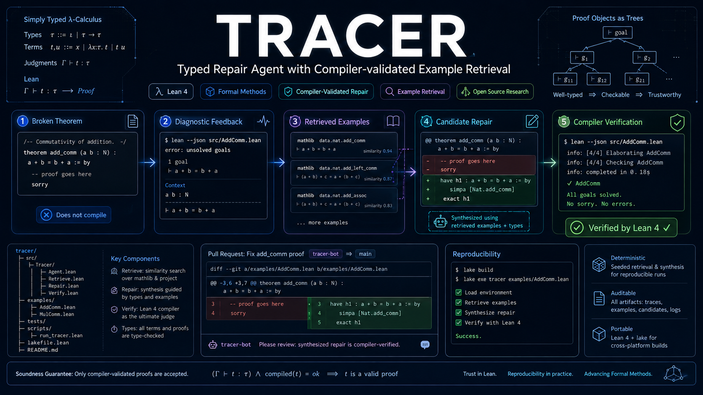
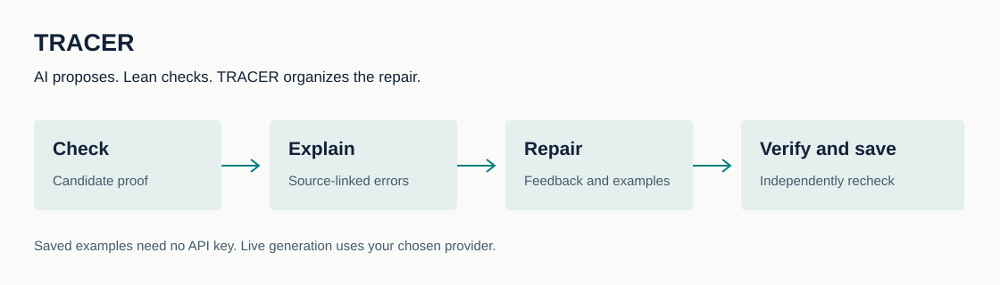

# TRACER

[English](README.md) | [简体中文](README.zh-CN.md) | **日本語** | [한국어](README.ko.md)

**AI が書いた数学の証明を修復し、Lean で毎回検証します。**

[Website](https://runqiwang777.github.io/TRACER/ja.html) · [Demo](https://runqiwang777.github.io/TRACER/demo/) · [API ガイド](docs/API_GUIDE.md)

 [](LICENSE)



TRACER は言語モデルと証明検証システム Lean をつなぎます。エラー情報や関連する例をモデルに渡し、修正した証明をもう一度検証します。

Lean を初めて知る方へ：命題と証明の各ステップをコードで記述すると、Lean が定義と仮定に照らして正しさを検証します。もっともらしい文章だけでは合格できません。

## TRACER を試す

### [保存済みの修復例 24 件を見る](https://runqiwang777.github.io/TRACER/demo/)

インストールも API キーも不要です。保存済みの例を表示し、モデルへの通信は行いません。



## 使われなかった条件を見つける

x = y と y = z から x = z を示します。最初の等式だけでは証明が足りません。

```lean
-- x = y, y = z; goal: x = z
-- rejected
by exact hxy
-- accepted
by exact hxy.trans hyz
```

Lean が結論の不一致を指摘します。TRACER は原文を保持し、関連情報をモデルに渡します。 二つの等式をつなぐと、この例は Lean の検証を通過します。 仕組みを説明するための例です。デモには実験から保存した失敗と修復の例も 24 件あります。

## TRACER でできること

| | |
| --- | --- |
| **証明候補を検証** | 命題と依存関係を固定して候補をコンパイルします。 |
| **エラーを整理** | 原文を保持し、不明な名前、型の違い、未完了の目標を根拠とともに抽出します。 |
| **修復を試す** | フィードバックと、設定に応じた関連例を渡します。試行回数には上限を設けます。 |
| **検証可能な記録を保存** | 候補、エラー、使用量、成功した証明を保存し、独立した再検証を可能にします。 |

## 完了した研究で分かったこと

異なる 24 問を、2 種類のモデル設定と複数の条件で繰り返し実行し、864 件のタスク実行を得ました。864 個の異なる定理ではありません。

| | Lean 検証の成功数 |
| --- | ---: |
| 最初の試行 | 735/864 (85.1%) |
| 最大 3 回の試行 | 811/864 (93.9%) |

**初回に失敗したうち、追加の 76 件が後の試行で成功しました。** 85.1% から 93.9% への変化には再試行の効果も含まれます。すべてをフィードバックの効果とは解釈できません。

エラーを渡さず再試行する条件と比べると、Flash の成功数は同じ、Pro は 2 件少ない結果でした。各条件は 72 件です。安定したフィードバックの優位性はまだ確認していません。

Lean の合格は、指定の環境と仮定の下での形式的妥当性を示します。AI 支援レビューは完全な人手の数学的審査ではありません。オフラインの安全テストと一度の Linux コンテナ実行も、万能なサンドボックスの保証にはなりません。

過去の完全な実験パッケージはローカルに保存しています。このリポジトリでは 24 件の例をブラウザーで確認できます。 [データと出典](docs/INTRODUCTION_EVIDENCE.md).

## ベンチマークと実験設計

固定ベンチマークは、5つの独立したプロジェクトから集めた**異なる修復タスク254件**で構成されます。

| プロジェクト | 件数 |
| --- | ---: |
| Equational Theories | 53 |
| FLT | 47 |
| LeanAPAP | 16 |
| PFR | 44 |
| PhysLean | 94 |
| **合計** | **254** |

完了済みの6条件パイロットでは、24問を2種類のモデル設定で各3回実行しました（**24 × 2 × 3 × 6 = 864実行**）。これは繰り返し実行されたタスク数であり、異なる問題が864件あるという意味ではありません。

事前登録済みの大規模実験では、DeepSeekとGLMで8条件、MiniMaxで確認用の3条件を実施し、各タスクを3回実行します。8条件は、フィードバックなしの再試行、完全なコンパイラエラー、正規化したエラー、正確な構造化診断、エラー種別を合わせた別問題の診断、重要な事実を一つ変更した診断、コンパイラフィードバックなしの検索例、適応的なフィードバック選択です。MiniMaxでは、再試行、正確な構造化診断、反事実診断の3条件を実施します。

初回生成の計画数はDeepSeek/GLMで1,524件、MiniMaxで762件です。条件を満たす初回失敗だけが後続の分岐に進みます。事前登録上の最大生成数は**16,764回**です。これは設計上の上限であり、完了結果ではありません。最終結果には監査済みの適格数と完了数を記載します。

## ツールの先にある研究課題

**モデルはエラーの意味を利用したのか、それとも、もう一度試せたから成功したのか？**

- **同じ失敗から比較.** 同一の失敗した証明を使い、次の試行に渡す情報だけを変えます。
- **情報の利用を確認.** 抽出した項目を原文に対応させ、修正が具体的なエラーに関係するか調べます。
- **実際の保守作業を対象にする.** 複数プロジェクトの修復履歴から問題を構成し、参照解を生成処理から分離します。

**難しい点:** 名前の欠落、型の不一致、未完了の目標、依存関係の変更は、それぞれ異なる失敗を生みます。必要な文脈の保持、解答漏洩の防止、API 障害との区別、実際の時間とトークンの計測が必要です。

## 完了・進行中・今後の計画

| | |
| --- | --- |
| **完了** | 回数制限付き修復、根拠を保持した診断、例の検索、証明の保存、再現可能な失敗例 24 件、5 プロジェクトからの修復履歴に基づくテスト 254 問。 |
| **進行中** | DeepSeek、GLM、MiniMax を使う比較研究。最終結果は記録の監査と独立再コンパイル後に公開します。このページは実行状況のライブ監視ではありません。 |
| **計画** | 診断内の事実を一つだけ変えて編集への影響を調べます。その後、エラーに応じた情報の選択を独立したデータで検証します。 |

## ローカルで小さな例を実行

Python 3.11 以上と、リポジトリが指定する Lean ツールチェーンを用意して実行します。

```bash
git clone https://github.com/runqiwang777/TRACER.git
cd TRACER
python -m pip install -r requirements.txt
lake build
python src/agent.py solve --file docs/examples/equality_chain.lean --theorem equality_chain --provider mock --mock-candidate "by exact hxy.trans hyz"
```

固定した候補でコンパイルと保存を試します。モデルを呼び出さず、モデルの能力評価には使えません。

モデルに証明を生成させる場合は API ガイドをご覧ください。キーは端末で非表示入力します。有料の呼び出しでは必要なコードと診断が選択したプロバイダーに送信されます。

## ドキュメント

- [API ガイド](docs/API_GUIDE.md)
- [証明修復と失敗の再現](docs/CAPSULE_FORMAT.md) · [事例集](capsules/index.md)
- [方法と証拠の範囲](docs/INTRODUCTION_EVIDENCE.md) · [進捗](PROGRESS.md)
- [フィードバック比較](docs/V3_EXPERIMENT_PROTOCOL.md) · [実行時の安全性](docs/security_policy.md)
- [オフライン安全テスト](published/security-study-tracer-sp-v2/) · [Linux 隔離の記録](published/security-isolation-tracer-sp-v1/)
- [貢献方法](CONTRIBUTING.md) · [関連研究](docs/RELATED_WORK.md)

LeanDojo、Baldur、APOLLO は対話・検索・修復の参考です。Li と Li はフィードバック比較の重要な参考研究です。TRACER は実プロジェクトの診断情報、確認可能な編集、情報利用のコストを調べます。

## 引用と謝辞

MIT ライセンスです。引用時はソフトウェアの版と証拠の実験バッチを明記してください。SJTU AI4Math Summer School 2026 とコミュニティの皆様に感謝します。 [CITATION.cff](CITATION.cff) · [MIT](LICENSE) · [SJTU AI4Math Summer School 2026](https://sjtu-ai4math.github.io/summer-school/2026/).

<sub>Typed Repair Agent with Compiler-validated Example Retrieval</sub>
