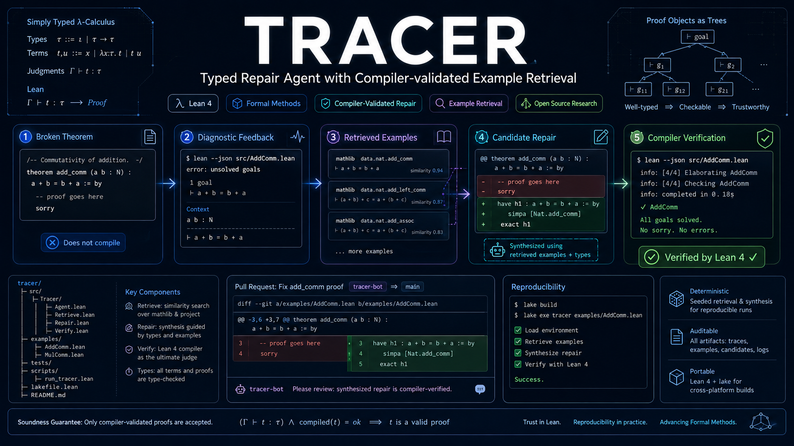
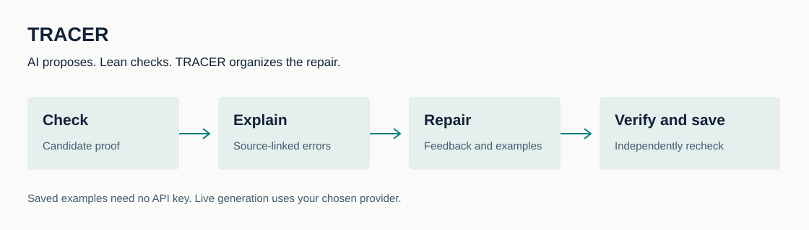

# TRACER

[English](README.md) | [简体中文](README.zh-CN.md) | [日本語](README.ja.md) | **한국어**

**AI가 작성한 수학 증명을 수정하고, Lean으로 매번 검증합니다.**

[Website](https://runqiwang777.github.io/TRACER/ko.html) · [Demo](https://runqiwang777.github.io/TRACER/demo/) · [API 가이드](docs/API_GUIDE.md)

 [](LICENSE)



TRACER는 언어 모델과 수학 증명 검사기 Lean을 연결합니다. 오류 정보와 관련 예제를 모델에 제공하고, 수정한 증명을 다시 검사합니다.

Lean이 처음이라면: 명제와 증명 단계를 코드로 작성하면 Lean이 정의와 가정에 따라 각 단계를 검사합니다. 그럴듯한 설명만으로는 통과할 수 없습니다.

## TRACER 체험

### [저장된 수정 사례 24개 보기](https://runqiwang777.github.io/TRACER/demo/)

설치와 API 키가 필요 없습니다. 저장된 사례를 보여 주며 모델을 실시간으로 호출하지 않습니다.



## 빠진 증명 단계를 찾는 예

x = y와 y = z를 이용해 x = z를 증명합니다. 첫 번째 등식만 쓰면 한 단계가 빠집니다.

```lean
-- x = y, y = z; goal: x = z
-- rejected
by exact hxy
-- accepted
by exact hxy.trans hyz
```

Lean이 결론의 불일치를 알려 줍니다. TRACER는 원문을 보존하고 관련 정보를 모델에 전달합니다. 두 등식을 연결하면 이 예제는 Lean 검사를 통과합니다. 흐름을 설명하는 교육용 예제입니다. 데모에는 실험에서 저장한 실패와 수정 사례도 24개 있습니다.

## TRACER가 하는 일

| | |
| --- | --- |
| **증명 후보 검사** | 명제와 의존성을 고정하고 제안된 증명을 컴파일합니다. |
| **오류 정리** | 원문을 보존하고, 찾을 수 없는 이름과 타입 차이 및 남은 목표를 근거와 함께 추출합니다. |
| **수정 시도** | 피드백과 설정에 따른 관련 예제를 제공합니다. 시도 횟수에는 상한이 있습니다. |
| **근거 저장** | 후보, 오류, 사용량 및 성공한 증명을 저장해 독립적인 재검증을 지원합니다. |

## 완료한 연구에서 확인한 결과

서로 다른 24문제를 두 모델 설정과 여러 조건에서 반복하여 864개의 작업 실행을 얻었습니다. 서로 다른 정리 864개를 뜻하지 않습니다.

| | Lean 검사 통과 수 |
| --- | ---: |
| 첫 번째 시도 | 735/864 (85.1%) |
| 최대 세 번의 시도 | 811/864 (93.9%) |

**첫 시도에서 실패한 작업 중 76개가 이후 시도에서 추가로 성공했습니다.** 85.1%에서 93.9%로의 변화에는 재시도 효과도 포함됩니다. 전부 피드백의 효과로 해석할 수 없습니다.

오류 없이 다시 시도하는 조건과 비교하면 Flash의 성공 수는 같고 Pro는 2개 적었습니다. 조건마다 72개 작업입니다. 피드백의 안정적인 우위는 아직 확인되지 않았습니다.

Lean 통과는 주어진 환경과 가정 아래에서의 형식적 유효성을 뜻합니다. AI 보조 검토는 완전한 사람의 수학적 심사가 아닙니다. 오프라인 안전 테스트와 한 차례 Linux 컨테이너 실행도 범용 샌드박스를 보장하지 않습니다.

이전 실험의 전체 패키지는 로컬에 보관되어 있으며, 이 저장소에서는 24개 사례를 브라우저로 확인할 수 있습니다. [데이터 및 출처](docs/INTRODUCTION_EVIDENCE.md).

## 벤치마크와 실험 설계

고정 벤치마크는 서로 독립적인 5개 프로젝트에서 수집한 **서로 다른 증명 수정 과제 254개**로 구성됩니다.

| 프로젝트 | 과제 수 |
| --- | ---: |
| Equational Theories | 53 |
| FLT | 47 |
| LeanAPAP | 16 |
| PFR | 44 |
| PhysLean | 94 |
| **합계** | **254** |

완료된 6조건 파일럿은 24개 문제를 두 가지 모델 설정에서 각각 3회 실행했습니다(**24 × 2 × 3 × 6 = 864회 실행**). 이는 반복 실행 수이며 서로 다른 문제가 864개라는 뜻은 아닙니다.

사전 등록된 대규모 실험은 DeepSeek와 GLM에서 8개 조건, MiniMax에서 확인용 3개 조건을 각 과제마다 3회 수행합니다. 8개 조건은 피드백 없는 재시도, 전체 컴파일 오류, 정규화된 오류, 정확한 구조화 진단, 오류 유형만 같은 다른 문제의 진단, 핵심 사실 하나를 바꾼 진단, 컴파일 피드백 없이 검색 예제만 제공, 적응형 피드백 선택입니다. MiniMax는 재시도, 정확한 구조화 진단, 반사실 진단의 세 조건을 실행합니다.

초기 생성 계획은 DeepSeek/GLM 1,524회, MiniMax 762회입니다. 기준을 충족한 첫 시도 실패만 후속 분기로 진행합니다. 사전 등록된 최대 생성 횟수는 **16,764회**입니다. 이는 설계상 상한이며 완료된 결과 수가 아닙니다. 최종 결과에는 감사를 마친 적격 수와 완료 수를 보고합니다.

## 도구를 넘어 확인하려는 질문

**모델은 오류 메시지의 의미를 활용했을까요, 아니면 한 번 더 시도해서 성공했을까요?**

- **같은 실패에서 비교.** 동일한 실패 증명을 재사용하고 다음 시도에 제공하는 정보만 바꿉니다.
- **정보가 쓰였는지 확인.** 추출 항목을 원문과 연결하고 수정이 해당 오류와 관련 있는지 살펴봅니다.
- **실제 유지보수 작업 평가.** 여러 프로젝트의 수정 이력에서 문제를 만들고, 참조 정답을 생성 과정과 분리합니다.

**어려운 점:** 이름 누락, 타입 불일치, 미해결 목표, 의존성 변경은 서로 다른 실패를 만듭니다. 필요한 문맥 보존, 정답 유출 방지, API 장애 구분, 실제 시간과 토큰 비용 측정이 필요합니다.

## 완료한 일, 진행 중인 일, 계획

| | |
| --- | --- |
| **완료** | 횟수가 제한된 수정, 근거가 연결된 진단, 예제 검색, 증명 저장, 재현 가능한 실패 24개, 5개 프로젝트의 과거 수정에서 만든 테스트 254문제. |
| **진행 중** | DeepSeek, GLM, MiniMax를 사용하는 비교 연구입니다. 최종 결과는 전체 기록 감사와 독립 재컴파일 후 공개합니다. 이 페이지는 실시간 실행 모니터가 아닙니다. |
| **계획** | 진단의 사실 하나만 바꿔 코드 수정에 미치는 영향을 검사합니다. 이후 오류에 따른 피드백 선택을 독립 데이터에서 평가합니다. |

## 로컬에서 작은 예제 실행

Python 3.11 이상과 저장소가 지정한 Lean 도구 체인을 준비한 뒤 실행하세요.

```bash
git clone https://github.com/runqiwang777/TRACER.git
cd TRACER
python -m pip install -r requirements.txt
lake build
python src/agent.py solve --file docs/examples/equality_chain.lean --theorem equality_chain --provider mock --mock-candidate "by exact hxy.trans hyz"
```

고정된 후보로 컴파일과 저장을 시험합니다. 모델 호출이 없으며 모델 성능 평가는 아닙니다.

실제 모델 생성은 API 가이드를 참고하세요. 키는 터미널에서 숨겨 입력합니다. 유료 요청은 필요한 코드와 진단을 선택한 제공업체로 전송합니다.

## 문서

- [API 가이드](docs/API_GUIDE.md)
- [증명 수정 및 실패 재현](docs/CAPSULE_FORMAT.md) · [사례 모음](capsules/index.md)
- [방법과 근거의 범위](docs/INTRODUCTION_EVIDENCE.md) · [진행 상황](PROGRESS.md)
- [피드백 대조 연구](docs/V3_EXPERIMENT_PROTOCOL.md) · [실행 안전](docs/security_policy.md)
- [오프라인 안전 근거](published/security-study-tracer-sp-v2/) · [Linux 격리 근거](published/security-isolation-tracer-sp-v1/)
- [기여 방법](CONTRIBUTING.md) · [관련 연구](docs/RELATED_WORK.md)

LeanDojo, Baldur, APOLLO는 상호작용과 검색, 수정 흐름의 참고 연구입니다. Li와 Li는 피드백 대조 실험의 중요한 참고 연구입니다. TRACER는 실제 프로젝트의 진단 정보, 검증 가능한 수정 행동, 피드백 사용 비용을 연구합니다.

## 인용 및 감사

MIT 라이선스입니다. 인용할 때 소프트웨어 버전과 근거 실험 배치를 명시해 주세요. SJTU AI4Math Summer School 2026과 커뮤니티 검토자께 감사드립니다. [CITATION.cff](CITATION.cff) · [MIT](LICENSE) · [SJTU AI4Math Summer School 2026](https://sjtu-ai4math.github.io/summer-school/2026/).

<sub>Typed Repair Agent with Compiler-validated Example Retrieval</sub>
