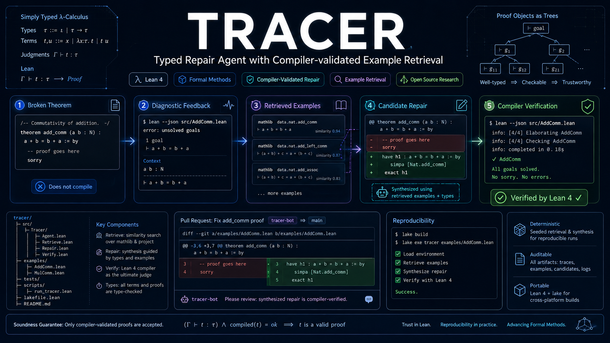

# TRACER

**English** | [简体中文](README.zh-CN.md) | [Project website](https://runqiwang777.github.io/TRACER/)

### Typed Repair Agent with Compiler-validated Example Retrieval



TRACER studies **when compiler feedback helps language models repair Lean 4 proofs in real projects**. Its preregistered v3 study covers **DeepSeek-v4-Pro, GLM-4.5, and MiniMax-M3** through three first-party providers. The toolkit connects candidate proofs to real Lean compilation, source-linked diagnostics, retrieval, bounded retries, and auditable proof artifacts. It does not train or fine-tune models.

[](https://github.com/runqiwang777/TRACER/actions/workflows/ci.yml)
[](lean-toolchain)
[](LICENSE)

> [!IMPORTANT]
> **[Explore the TRACER website and 24-case demo](https://runqiwang777.github.io/TRACER/)**. The static explorer shows stored Lean failures and repairs without an API key. The full prior repair24 release remains in the local archive; this repository includes the embedded 24-case replay.

## Current deliverables

- **Repair and causal-study infrastructure:** frozen TRACER-REAL v2 benchmark enrollment and v3 preregistered protocol. This upload does not include an audited final provider result package; local run status is not inferred from the repository contents.
- **Compiler feedback:** raw, normalized, and structured diagnostic layers with retained source evidence and offline failure fixtures.
- **LeanCapsule:** 24 replayable failures across Std, Mathlib, and project-local environments.
- **Security:** SP-1–SP-12 pre-compilation policy cases with 8 benign controls; one Linux container run observed 14/14 declared controls. Windows Docker Desktop remains pending.

Published security artifacts: [SP v2 offline policy results](published/security-study-tracer-sp-v2/) · [Linux isolation report](published/security-isolation-tracer-sp-v1/).

## Quick start

Requirements: Python 3.11+, Git, and Lean via `elan`. The repository pins Lean in [lean-toolchain](lean-toolchain).

```bash
git clone https://github.com/runqiwang777/TRACER.git
cd TRACER
python -m pip install -r requirements.txt
lake build
python -m leancapsule audit capsules
```

Replay a frozen failure (success means the expected failure was reproduced):

```bash
python -m leancapsule replay capsules/std/unknown-identifier
```

For a real model request, configure a supported provider as described in [API_GUIDE.md](docs/API_GUIDE.md). Requests may incur charges; never put credentials in source files, command history, or result artifacts.

## Research focus

The goal is to identify **which diagnostic information helps, for which errors and projects, and whether the effect holds across model families**. The frozen TRACER-REAL v2 test set contains 254 historical repairs from five independent upstream projects. Within each model, task, and repeat, v3 branches from the same failed first candidate so that another generation attempt can be distinguished from the information supplied by feedback.

| Frozen model | Provider | v3 scope |
| --- | --- | --- |
| `deepseek-v4-pro` | DeepSeek | Eight arms, three repeats |
| `glm-4.5` | Zhipu BigModel | Eight arms, three repeats |
| `MiniMax-M3` | MiniMax China | Three confirmatory arms, three repeats |

All three models share the confirmatory contrast `true_structured - content_free_retry` and the `counterfactual` control. DeepSeek and GLM additionally compare raw and normalized diagnostics, matched irrelevant feedback, retrieval-only, and adaptive routing. Structured signals retain links to their original diagnostic evidence.

This model coverage extends the study beyond a single provider or specialized prover. Combined with real-project repairs and diagnostic-representation controls, it supports a distinct investigation of feedback's external validity. Model-specific eligible failures are analyzed separately; model choice alone does not establish an improvement.

[Li and Li (2026)](https://arxiv.org/abs/2610.22698) is an important reference for TRACER's feedback controls; see [related work](docs/RELATED_WORK.md) for context.

**Evidence status:** the frozen protocol is available; this repository does not yet contain the fully audited final v3 provider release. Equal generation counts and output caps do not imply equal actual token expenditure. See the [experiment protocol](docs/V3_EXPERIMENT_PROTOCOL.md) and [research priorities](docs/RESEARCH_POSITIONING.md) for analysis and release gates. SP-1–SP-12 remain separate security policies.

## Validation

```bash
python -m unittest discover -s tests -v
lake build
python scripts/verify_compiler_feedback_v1.py --verify-only
python src/tracer_real_v2.py audit
python src/security_study.py --check published/security-study-tracer-sp-v2/report.json
python scripts/audit_security_isolation_release.py published/security-isolation-tracer-sp-v1
python -m leancapsule audit capsules
python -m leancapsule verify capsules
```

Capsule verification needs the pinned project dependencies. Offline tests and audits do not call paid model APIs. Passing software checks does not establish a research hypothesis or prove a complete sandbox.

## Documentation

- [Provider/API setup](docs/API_GUIDE.md)
- [Compiler feedback protocol](docs/COMPILER_FEEDBACK_V1.md) · [feedback adoption analysis](docs/FEEDBACK_ADOPTION_V1.md)
- [TRACER-REAL v2 benchmark](docs/TRACER_REAL_V2.md) · [v3 experiment](docs/V3_EXPERIMENT_PROTOCOL.md)
- [v3 release naming and existing runs](docs/RELEASE_NAMING.md)
- [LeanCapsule format](docs/CAPSULE_FORMAT.md) · [failure gallery](capsules/index.md)
- [SP security policy](docs/security_policy.md) · [isolation protocol](docs/SP_ISOLATION_V1.md)
- [Research priorities and contribution scope](docs/RESEARCH_POSITIONING.md)
- [Related work](docs/RELATED_WORK.md) · [Progress register](PROGRESS.md)

## Citation and license

For research or teaching use, cite [CITATION.cff](CITATION.cff) and identify the exact version and experiment batch. The project is under the [MIT License](LICENSE); capsules retain their individual source licenses.
