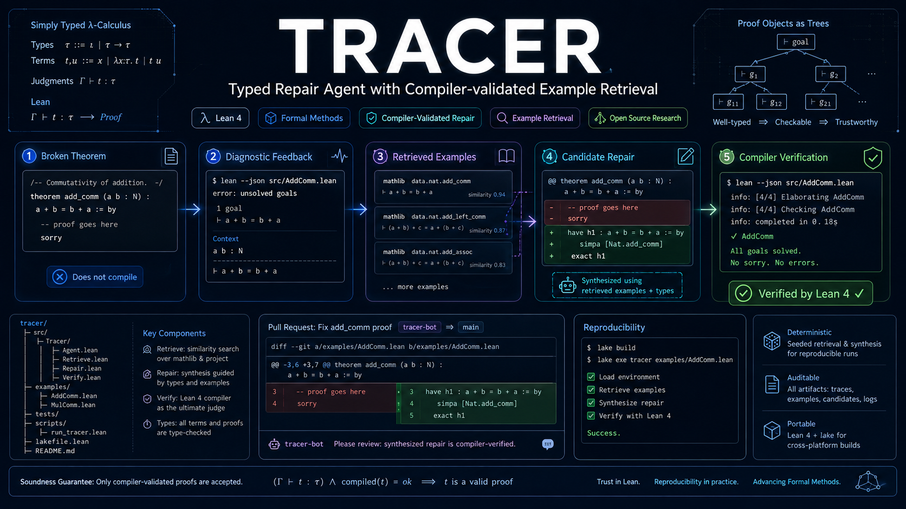

# TRACER

[English](README.md) | **简体中文** | [项目网站](https://runqiwang777.github.io/TRACER/)

### Typed Repair Agent with Compiler-validated Example Retrieval



TRACER 研究**编译反馈在什么条件下能帮助语言模型修复真实项目中的 Lean 4 证明**。预注册的 v3 实验覆盖 **DeepSeek-v4-Pro、GLM-4.5 与 MiniMax-M3**，分别通过三家一方 API 调用。工具链连接候选证明、真实 Lean 编译、保留来源证据的诊断、检索、有界重试与可审计证明工件；项目不训练或微调模型。

[](https://github.com/runqiwang777/TRACER/actions/workflows/ci.yml)
[](lean-toolchain)
[](LICENSE)

> [!IMPORTANT]
> **[打开 TRACER 网站与 24 案例演示](https://runqiwang777.github.io/TRACER/)**。静态网页展示已保存的 Lean 失败与修复，无需 API key。完整的旧 repair24 发布包目前留在本机归档；本仓库包含 24 案例网页回放。

[开题报告（PDF）](docs/proposal/TRACER_Proposal.pdf) · [5 分钟汇报（PPTX）](docs/proposal/TRACER_5min_Talk.pptx) · [逐页讲稿](docs/proposal/TALK.zh-CN.md)

## 当前交付内容

- **修复与因果实验基础设施：** 已冻结 TRACER-REAL v2 基准纳入方案和 v3 预注册协议。本次上传未包含完成审计的 provider 最终结果包；不能根据仓库缺少结果文件推断本地运行是否完成。
- **编译反馈：** 原始、规范化和结构化诊断层，保留来源证据，并提供离线失败夹具。
- **LeanCapsule：** 24 个可回放失败案例，覆盖 Std、Mathlib 和 project-local 环境。
- **安全：** SP-1～SP-12 编译前策略案例及 8 个正常对照；一次 Linux 容器运行观察到声明的 14/14 项控制。Windows Docker Desktop 尚待验证。

已发布安全工件：[SP v2 离线策略结果](published/security-study-tracer-sp-v2/) · [Linux 隔离报告](published/security-isolation-tracer-sp-v1/)。

## 快速开始

需要 Python 3.11+、Git 和通过 `elan` 安装的 Lean。仓库在 [lean-toolchain](lean-toolchain) 中固定 Lean 版本。

```bash
git clone https://github.com/runqiwang777/TRACER.git
cd TRACER
python -m pip install -r requirements.txt
lake build
python -m leancapsule audit capsules
```

回放一个冻结失败案例（成功表示预期失败被复现）：

```bash
python -m leancapsule replay capsules/std/unknown-identifier
```

真实模型请求的配置方法见 [API_GUIDE.md](docs/API_GUIDE.md)。请求可能产生费用；不要把凭据写入源码、命令历史或结果工件。

## 研究重点

TRACER 研究诊断中的信息、可观察的修复行为，以及使用反馈的成本。主线保留四个问题：

- **RQ1：是否有效？** 同一失败起点上，正确反馈能否优于再生成一次？
- **RQ2：语义是否重要？** 真实、无关和反事实诊断会引起怎样的修改与结果？
- **RQ3：哪种表示有用？** 原始、规范化和结构化诊断保留什么信息，成本如何？
- **RQ4：何时、如何起作用？** 效果依赖什么错误状态，反馈选择能否在独立数据上验证？

冻结的 TRACER-REAL v2 测试集包含五个上游项目的 254 道历史修复题。v3 在同模型、同题、同重复内固定合格首轮失败候选再分叉。

| 冻结模型 | 供应商 | v3 实验范围 |
| --- | --- | --- |
| `deepseek-v4-pro` | DeepSeek | 八臂、三次重复 |
| `glm-4.5` | 智谱 BigModel | 八臂、三次重复 |
| `MiniMax-M3` | MiniMax 中国区 | 三条确认臂、三次重复 |

三模型共同运行 `true_structured - content_free_retry` 主对比及 `counterfactual` 负对照。DeepSeek 与 GLM 还比较原始和规范化诊断、同类无关反馈、只检索及冻结的 adaptive 原型。三个供应商扩展验证范围；模型不同本身不等于方法或性能优势已经成立。

**R1 路线：** 完成并审计当前冻结 v3（**E1**），分析现有诊断的忠实性、修改、错误转移及成本（**E2**），再独立预注册字段级定向语义干预（**E3**）。新错误感知路由规则需独立验证（**E4**）；这些后续工作不改变正在进行的 v3 协议。

[Li 与 Li（2026）](https://arxiv.org/abs/2610.22698) 是反馈对照设计的重要参考。TRACER 拟形成的增量结合真实历史修复、诊断信息结构与可验证行为证据，具体背景见[相关工作](docs/RELATED_WORK.md)。

**证据状态：** 本仓库尚未包含经过全量审计的 v3 provider 最终发布包。生成次数与输出上限相同，不代表实际 token 消耗相同。参见[冻结协议](docs/V3_EXPERIMENT_PROTOCOL.md)和[R1 研究重点](docs/RESEARCH_POSITIONING.md)。SP-1～SP-12 仍是独立安全策略。

## 验证

```bash
python -m unittest discover -s tests -v
lake build
python scripts/verify_compiler_feedback_v1.py --verify-only
python src/tracer_real_v2.py audit
python src/security_study.py --check published/security-study-tracer-sp-v2/report.json
python scripts/audit_security_isolation_release.py published/security-isolation-tracer-sp-v1
python -m leancapsule audit capsules
python -m leancapsule verify capsules
```

Capsule 全量验证需要准备固定项目依赖。离线测试和审计不会调用付费模型 API。软件检查通过不等于研究假设成立，也不能证明形成了完整沙箱。

## 文档

- [Provider/API 配置](docs/API_GUIDE.md)
- [编译反馈协议](docs/COMPILER_FEEDBACK_V1.md) · [反馈采纳分析](docs/FEEDBACK_ADOPTION_V1.md)
- [TRACER-REAL v2 题库](docs/TRACER_REAL_V2.md) · [v3 实验](docs/V3_EXPERIMENT_PROTOCOL.md)
- [v3 公开命名与既有运行](docs/RELEASE_NAMING.md)
- [LeanCapsule 格式](docs/CAPSULE_FORMAT.md) · [失败案例库](capsules/index.md)
- [SP 安全策略](docs/security_policy.md) · [隔离协议](docs/SP_ISOLATION_V1.md)
- [研究重点与贡献边界](docs/RESEARCH_POSITIONING.md)
- [相关工作](docs/RELATED_WORK.md) · [进度登记](PROGRESS.md)

## 引用与许可

研究或教学使用时，请引用 [CITATION.cff](CITATION.cff)，并注明仓库版本和实验批次。项目采用 [MIT License](LICENSE)；各 Capsule 保留其来源许可。
